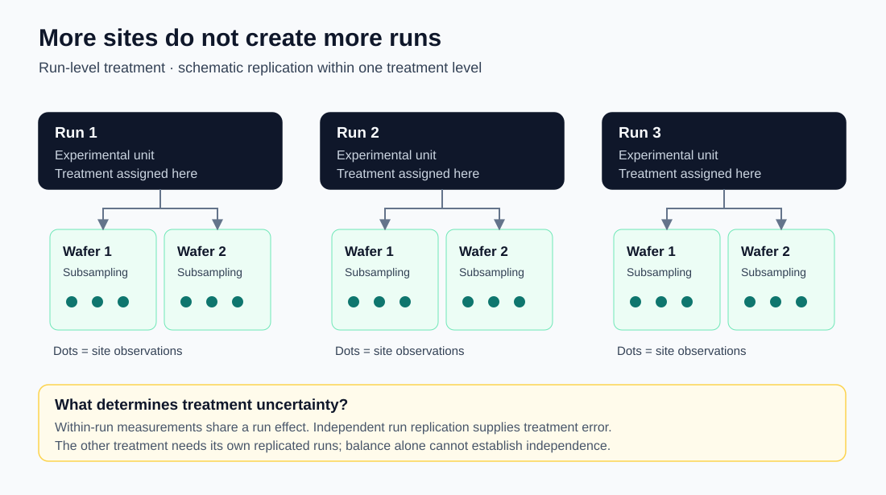

# Stratum

**Can this declared experiment support the comparison being requested?**

Stratum is a small Python command-line tool that checks a wafer-level experiment's declared
design against its data before applying a supported balanced analysis. It validates
hierarchy, replication, balance, confounding and estimability, then reports the error term
and the independent units behind each comparison. When the design cannot support a
comparison, Stratum refuses with stated reasons instead of producing a number. It is not a
general mixed-model package.

If a recipe is applied to a whole run, **the run is the experimental unit**. Wafers and
sites measure what happened inside that run. More of them improve the run's average; they
do not create independent runs, and they cannot separate a recipe from a chamber that was
used only for it.



| Template | Supported structure | What supplies the error |
|---|---|---|
| T1 | Three-level nested variance components, no treatment | Separate top, middle and observation strata |
| T2 | One treatment applied to replicated upper-level units, with balanced subsampling | Units within treatment |
| T2 with a block | The same comparison, balanced across one recorded block | Residual of the additive treatment + block model on unit means |
| T3 | Balanced split-plot: whole-plot factor, subplot factor and their interaction | Whole-plot error for A; subplot error for B and A×B |

Stratum refuses unsupported structures, missing independent replication, non-estimable
contrasts, complete confounding, partial confounding with an unbalanced assignment and
unit-level imbalance. It never repairs a design by dropping rows or inventing
replication. One narrow T2 exception permits missing **exchangeable lowest-level sites**
while every higher unit is retained; the treatment inference then uses hierarchical unit
means and is labeled approximate.

The implementation combines exact rational arithmetic for means, sums of squares and
estimability with balanced ANOVA, signed method-of-moments variance components, a
closed-form order-restricted REML cross-check, and allocation calculations that expose the
upper-unit variance floor. An eligible completely confounded T2 design receives a crossed,
randomized assignment of **new** units; the refused comparison stays refused.

## Quick start

Python 3.9 or later is required. The only runtime dependency is PyYAML, pinned at 6.0.3.

```sh
python3 -m venv .venv
.venv/bin/python -m pip install -r requirements.txt
.venv/bin/python -m stratum --help
.venv/bin/python scenarios/run.py S3
```

The last command runs the synthetic split-plot demonstration and rewrites its stored
[report](scenarios/S3-split-plot/output/report.md), results, assertion comparison and
[write-up](scenarios/S3-split-plot/WRITEUP.md). `S1` shows chamber confounding, `S2` shows
missing run replication, and `--all` runs all three. The [demonstration guide](docs/DEMO.md)
walks through what each one shows.

To analyze a declared design:

```sh
.venv/bin/python -m stratum analyze design.yaml measurements.csv --out output
.venv/bin/python -m stratum report output/results.json --out output/report.md
```

Start from an [example declaration](declarations/examples) and the
[declaration schema](declarations/README.md). Declare the actual hierarchy, assignment,
counts, nuisance factors and intended comparisons. CSV headers must be unique; an empty
field or `NA` marks a missing response. Pairwise estimates are the first declared level
minus the second. `--synthetic` labels synthetic inputs whose file names do not already
say so. Every run records the SHA-256 of its inputs and of the Stratum source. A
scientific `REFUSE` writes its reasons and exits 0; input or operational errors exit 1 and
usage errors exit 2.

## Checks

```sh
python3 run_checks.py
```

This runs the unit tests and the fixture, registry, explanation, scenario, WP3 map and
missing-site policy checks. With the published reference data present, it also verifies
the reference sources and numbers, the WP3 published reproduction and the committed
reports; without that data those checks are reported as skipped, never as passed. See
[REPRODUCIBILITY.md](REPRODUCIBILITY.md) for what this snapshot can and cannot regenerate.

Scenario checks distinguish numerical agreement from byte identity. By default, finite
JSON floats must agree within `1e-12` relative error, with no absolute-error allowance;
structure, types, counts, decisions, provenance and write-ups stay exact. Each report must
render from its own results document. All 142 preregistered assertions remain unchanged.
Use `python3 run_checks.py --strict-bytes` to require byte-identical scenario outputs.
The retained Linux/Python 3.12.14 byte mismatch and the verification policy are explained
in [verification portability](REPRODUCIBILITY.md#verification-portability).

[Hosted checks](https://github.com/tjsingh143/Stratum/actions/workflows/checks.yml)
run the portable suite on Linux with Python 3.9, 3.12 and 3.14. Data-dependent checks
remain explicitly skipped when the separately fetched reference data are absent.

## Data

The data are **published textbook and NIST/SEMATECH datasets plus labeled synthetic
fixtures and simulations**. The reference set is MEMSS Oxide, SASmixed Semiconductor, the
NIST/SEMATECH furnace case study and, optionally, the NIST/SEMATECH lithography table.
Oxide is analyzed without its Source factor; the fixed positions in the lithography data
limit interpretation of its components. Book pages were unavailable for some targets:
package transcripts stay labeled as package sources, and unobtained book values stay blank.

The reference datasets are fetched and checksum-verified, never redistributed, because the
redistribution terms of the underlying data are not established.
[reference/README.md](reference/README.md) records sources, citations, licenses, data
dictionaries and known differences. Route, chamber, confounding and aliasing checks rely on
synthetic constructions; recovery on parametric synthetic data demonstrates software
behavior, **not process realism**. Method and data citations are collected in
[docs/DATA_AND_REFERENCES.md](docs/DATA_AND_REFERENCES.md).

## Validation and limitations

A frozen synthetic validation study covers **209 cells and 418,000 distinct seeded
attempts**, with criteria fixed before the simulations ran. Correct treatment tests on
conforming T2, blocked T2 and T3 designs were approximately nominal under the validated
conditions. Naive analyses that treat readings or pooled strata as the error had pooled
false-positive rates of **43.99%** (T2, including blocks) and **34.66%** (T3 whole-plot
factor A). Systematic unrecorded run-order drift raised the correct tests' false-positive
rates to 15.67% (T2) and 23.83% (T3 A). Unequal upper-level variances reduced T3 A coverage
to 88.88%. All 74,000 expected refusals occurred. The corrected study retains 38,773
boundary fits and 0 failed fits; its first execution had 11,933 serialization failures,
which were repaired and re-run on identical inputs.

**Upper-level variance-component intervals showed severe undercoverage.** The approximate
Satterthwaite intervals covered the T1 run component in **58.20% to 91.65%** of attempts
across cells (pooled 75.16%), and all **21 formal alerts** (12 run-component and 9
wafer-component cells, with errors in both directions for the middle component) remain
recorded. These are method limitations, not defects that were fixed: the intervals must not
be treated as reliably calibrated 95% intervals across this grid. Against published
references, 198 of 199 frozen comparisons and 40 of 40 supplementary checks matched; the
remaining one, a constant offset (`32 log 2`) in a stored REML criterion, stays recorded as
a failed comparison (identifier D-070 in the outputs).

These results support the exercised balanced treatment analyses under their assumptions.
They do not establish robustness for arbitrary data. Normality, equal variances and
independent experimental units matter; diagnostics warn and can be unavailable with few
units. The T2 missing-site exception has unequal precision and no component or allocation
decomposition. Confounding checks examine one recorded nuisance factor at a time, blocking
assumes additivity, unrecorded drift is not detected, and allocation ranges are approximate
with no validated coverage. All intervals are per comparison or component, without
multiplicity adjustment. There is no support for general unbalanced mixed models,
multistage regrouping, spatial analysis, process physics or power simulation.

[VALIDATION.md](VALIDATION.md) gives the measured coverage, Monte Carlo standard errors,
alerts, outcome accounting and reference agreement, and separates the checks run on this
repository from evidence retained from the original v1.0.0 release.
[METHODS.md](METHODS.md) explains the implemented formulas and their limits.

## Repository layout

| Path | Contents |
|---|---|
| `stratum/` | The package: declaration parsing, template matching, evidence checks, analysis, allocation, reassignment, results and report rendering, CLI |
| `resources/` | The plain-language explanation for each refusal and warning category, and its generated guide |
| `declarations/` | Declaration schema and example declarations for the reference datasets |
| `fixtures/synthetic_wp2/` | 65 synthetic fixtures with preregistered expected decisions, generator and runner |
| `scenarios/` | Three synthetic end-to-end demonstrations with preregistered assertions, outputs and write-ups |
| `reference/` | Pinned reference sources (fetched, not vendored), R scripts and Docker environment, stored R outputs, reference numbers and verifier |
| `reports/` | Generated reports for the four reference datasets and selected synthetic fixtures |
| `validation/` | Published-reference (WP3) reproduction, missing-site policy checks, the synthetic data generator and selected evidence from the simulation study |
| `tests/` | Unit and regression tests |
| `docs/` | Architecture, technical deep dive, code samples, demonstration guide, data and method references, diagrams |

## Documentation

- [METHODS.md](METHODS.md): models, expected mean squares, intervals, REML, missing data, diagnostics, allocation and reassignment.
- [VALIDATION.md](VALIDATION.md): test layers, simulation results, adverse conditions, outcome accounting and reference agreement.
- [REPRODUCIBILITY.md](REPRODUCIBILITY.md): environment, checks, the reference workflow and what this snapshot does not include.
- [docs/ARCHITECTURE.md](docs/ARCHITECTURE.md), [docs/TECHNICAL_DEEP_DIVE.md](docs/TECHNICAL_DEEP_DIVE.md) and [docs/CODE_SAMPLES.md](docs/CODE_SAMPLES.md): how the implementation is organized.
- [docs/DEMO.md](docs/DEMO.md): the three synthetic demonstrations.
- [docs/DATA_AND_REFERENCES.md](docs/DATA_AND_REFERENCES.md): datasets, redistribution status and citations.

## Identifiers in code and outputs

Source comments, messages and generated outputs cite stable identifiers: `T1`–`T3` are the
templates, `WP0`–`WP7` name the stage that implements a check (for example, WP2 evidence
checks and WP3 analysis), `D-nnn` identifies a design decision, and "brief Section n"
refers to a section of the project specification. The decision records (`DECISIONS.md`)
and the specification (`PROJECT_BRIEF.md`) that these identifiers cite are not part of
this repository; [METHODS.md](METHODS.md) and [VALIDATION.md](VALIDATION.md) document the
implemented behavior they govern.

## License and data terms

This repository does not include a license file, and no reuse license is granted or
implied. The reference datasets are not redistributed here; their sources, citations and
redistribution caveats are listed in [reference/README.md](reference/README.md).

## Review material

[Project portfolio](https://drive.google.com/drive/folders/1EQ2aAESu1FGiKtMuqSR7MYFVn54Xh8mG) contains the project overview, architecture,
code examples, testing notes, and supporting evidence. Portfolio measurements
retain their stated snapshot and verification boundaries.

[Review entry point](https://drive.google.com/file/d/1KuzKIEz3MjISgRvMFh1BXCNYw9X4qL9-/view?usp=drivesdk) · [Overview](https://drive.google.com/file/d/1VKmRXVDobR79CUpORpUHV5KbvzTNEZij/view?usp=drivesdk) · [Testing](https://drive.google.com/file/d/1gKUnnnKccnI-LflV3ivVTFpL8cyzr2v7/view?usp=drivesdk) · [Code samples](https://drive.google.com/file/d/1kCYGL4s-PQ5hfoNab3VC1DMv0fUDr2eW/view?usp=drivesdk)
