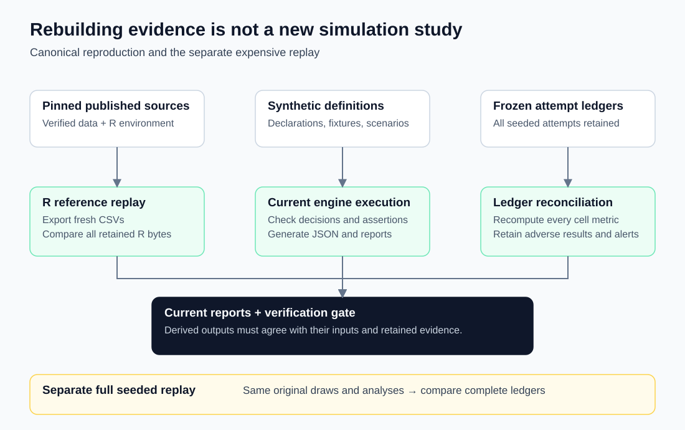

# Reproducibility

This repository is a curated snapshot of the Stratum v1.0.0 release. It contains the
complete analysis package, its tests, the synthetic fixtures and demonstrations, the
reference-data workflow and the generated reports. It contains only selected evidence from
the synthetic validation study. This page says what can be rerun from here and what is
reported as retained evidence.

## Environment

- Python 3.9 or later; the tested interpreter is Python 3.9.6.
- `requirements.txt` pins PyYAML 6.0.3, the only runtime dependency. The reference fetch
  and verification tools use the standard library only.
- Run commands from the repository root of a Git checkout. One test checks the Git
  provenance that ordinary CLI runs record; outside a checkout it is skipped.
- Docker is needed only for the pinned R reference replay.

```sh
python3 -m venv .venv
.venv/bin/python -m pip install -r requirements.txt
python3 run_checks.py
```

## What the checks cover

`python3 run_checks.py` runs, in order: the unit tests; the synthetic fixture generator and
registry checks; the explanation registry and its generated guide; the scenario inputs,
outputs and preregistered assertions; the WP3 comparison map; and the independent
missing-site policy derivations. These need no external data.

With the published reference data present, it also verifies the pinned source checksums,
every reference number and stored R output (`reference/verify.py`), the fixture comparison
table, the WP3 published reproduction and the 18 committed reports. Without that data
these checks print `SKIPPED`, and the unit tests that analyze the reference datasets are
skipped too; nothing is reported as passed that was not run.

## Verification portability

Python 3.9+ is the runtime requirement; it is not a guarantee that stored floating-point
outputs regenerate byte for byte on every interpreter and platform. Distribution routines
use the platform's math library. Last-digit differences in probabilities and quantiles can
also move a marker in a rendered diagnostic text plot. The strict checks retain these
differences as failures rather than replacing the stored evidence or widening a tolerance.

A fresh audit on Linux x86_64 with Python 3.12.14 and PyYAML 6.0.3 ran 421 unit tests:
one stored-output equality test failed and 36 reference-data tests were skipped. All 142
preregistered scenario assertions matched, but the separate scenario byte-comparison check
failed for S3. Overall, `run_checks.py` reported six groups passed, two failed and five
skipped. Its S3 probability for the whole-plot test was `0.2250449535046472`, compared with
the stored `0.22504495350464732`. This audit does not replace the recorded successful
Python 3.9.6 verification or establish byte-identical portability. Matching the interpreter
version alone may not reproduce a different platform's math-library results.

## Reference data

The published datasets are fetched and checksum-verified, not redistributed (see
[reference/README.md](reference/README.md) for sources and redistribution status).

```sh
python3 reference/fetch.py      # download and verify the 13 pinned sources
python3 reference/replay.py     # Docker: pinned R environment, CSV export, byte comparison
python3 run_checks.py           # now includes the data-dependent checks
```

`reference/replay.py` copies only the pinned inputs into a temporary directory, runs the
R scripts in a digest-pinned R 4.6.1 image with a dated package snapshot and checksummed
package sources, and requires every regenerated R output to equal the stored file byte for
byte. Only then does it write the derived CSV cache in `reference/_fetched/derived/`. It
never replaces the stored comparison targets. Byte-identical replay was recorded on Linux
arm64; other architectures are not certified to reproduce iterative-fit bytes, and a
mismatch fails rather than widening a tolerance. The replay was not re-run for this
snapshot; the data-dependent checks above used an existing local cache whose source and
derived files all matched their pinned checksums.

## Regenerating outputs

| Output | Command |
|---|---|
| Synthetic fixture inputs | `.venv/bin/python fixtures/synthetic_wp2/generate.py` |
| Fixture comparison table | `.venv/bin/python fixtures/synthetic_wp2/run_fixtures.py` |
| Scenario inputs | `python3 scenarios/generate.py` |
| Scenario outputs and write-ups | `.venv/bin/python scenarios/run.py --all` |
| Reference and fixture reports | `.venv/bin/python reports/generate.py` |
| WP3 comparison map | `python3 validation/build_wp3_map.py` |
| WP3 reproduction | `.venv/bin/python validation/wp3_reproduce.py` |
| Explanation guide | `.venv/bin/python -m stratum explanations --guide` |

Each of these has a `--check` mode, or a matching check in `run_checks.py`, that
regenerates in memory and fails on any byte difference. Committed outputs omit timestamps,
Git state and interpreter details. They record the SHA-256 of every input and a SHA-256 over
the files of the `stratum` package, so any edit under `stratum/` requires regenerating the
reports, the scenario outputs and the WP3 reproduction before their checks pass.
Interactive CLI runs additionally record the environment and the Git commit when available.
Allocation uses a fixed seed and draw count; reassignment seeds from the input hashes.

## What this repository does not include

- **The synthetic validation study's executable record**: the frozen simulation manifest
  and preregistration registry, the 418,000 per-attempt ledgers, the archive of the
  study's first execution, and the scripts that ran, scored, reconciled and replayed them.
  Their results are reported in [VALIDATION.md](VALIDATION.md) with verified extracts in
  [`validation/evidence/`](validation/evidence/); they cannot be regenerated from this
  repository. The synthetic data generator, `validation/wp6_generate.py`, is included.
- **The original release gate** and its logs. Its outcome is summarized in
  [`validation/evidence/original_release_gate.json`](validation/evidence/original_release_gate.json).
- **The development history.** The original release verified preregistration freezes
  against it; those history-based tests are listed in
  [VALIDATION.md](VALIDATION.md#test-changes).
- **The reference datasets**, which are fetched as described above.



The diagram shows how the original release regenerated its evidence. The frozen attempt
ledgers and the separate full replay belong to that release and are not part of this
repository.

## Relationship to the v1.0.0 release

Relative to the v1.0.0 release tree, the explanation registry moved to `resources/`, some
descriptive annotations and documentation were rewritten, the material listed above was
omitted, a few tests were adapted as described in [VALIDATION.md](VALIDATION.md#test-changes),
and the committed outputs were regenerated. Regeneration changed only provenance and
descriptive fields: the package source hash, the explanation file's path, hash and size,
the explanation policy note, and the wording of the "not obtained" reference note. No
estimate, test statistic, interval, decision, assertion, tolerance or explanation text
changed.
