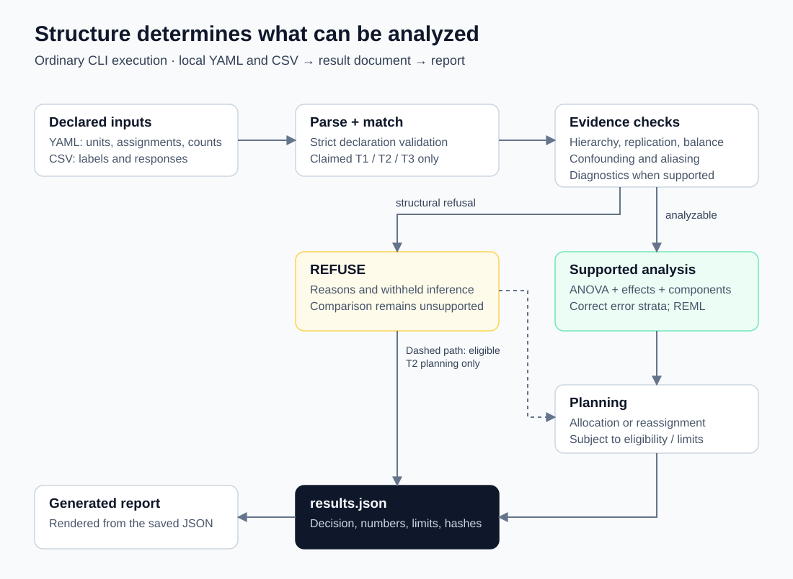

# Architecture

The ordinary runtime is a Python package with PyYAML as its pinned external dependency. R and Docker support reference reproduction; the CLI does not invoke them to analyze a declaration.

| Stage | Source | Responsibility |
|---|---|---|
| CLI | `stratum/cli.py` | Parse `analyze` / `report`, write JSON and Markdown, distinguish scientific refusal from operational failure |
| Declaration | `stratum/declaration.py` | Safe YAML loading with duplicate-key rejection, strict fields/types/references, immutable data classes |
| Template match | `stratum/templates.py` | Evaluate only the claimed T1/T2/T3 condition set; retain failed and unevaluated conditions |
| CSV | `stratum/data.py` | Reject ambiguous headers or row widths, retain cell text, parse decimal responses exactly |
| Evidence | `stratum/evidence.py` | Columns → cells → IDs → consistency → structure → confounding → aliasing → diagnostics |
| Analysis | `stratum/analysis.py` | Gate on evidence, form hierarchical means, dispatch T1/T2/T3, calculate ANOVA, effects, components and REML |
| Numerical support | `stratum/exact.py`, `stats.py`, `dist.py` | Rational geometry and projections; diagnostics; floating distribution tails and quantiles |
| Planning | `stratum/allocation.py`, `reassign.py` | Identified estimates or bounds, variance floor, deterministic uncertainty draws and eligible new-unit layouts |
| Results | `stratum/results.py` | Assemble `stratum-results/1`, findings, comparisons, hashes and availability states |
| Report | `stratum/report.py` | Render only from the JSON document, with traceable numeric reads |

Declaration matching precedes reading the data into the evidence pipeline. A match says that the declared shape is supported; it does not certify that the rows have that shape. Identity failures stop dependent checks. Structure, confounding and aliasing checks retain additional findings where they remain well-defined. A structural refusal prevents inferential diagnostics and statistical analysis.

A separate, restricted planning path can examine a refused T2 design if enough balanced structure survives. It never changes the comparison's refused status. Results therefore distinguish analysis, planning, unavailable quantities and refusal reasons.

`results.json` is the numerical source for the report. `Src` tracks the JSON paths consumed during rendering; tests exercise this trace as well as deterministic re-rendering. Standalone `report` needs the saved result document, rather than fitting the model again.

The surrounding directories support verification:

- `reference/` pins sources, exports reference CSVs, stores R comparison outputs and verifies source-specific numbers.
- `fixtures/synthetic_wp2/` defines small synthetic constructions and expected decisions.
- `scenarios/` runs three complete synthetic narratives, checking assertions and rendered outputs.
- `validation/` reproduces the published reference analyses (WP3), checks the missing-site policy derivations, holds the synthetic data generator used by the validation study, and keeps selected evidence from that study.
- `reports/` generates reference and selected fixture reports through the same results/report pipeline.
- `tests/` covers parsing, structure, mathematics, boundary behavior, planning, reports and CLI errors.

Ordinary analysis reads local declared inputs and writes a result directory. [Browse the source](../stratum/); [implementation details](TECHNICAL_DEEP_DIVE.md).
